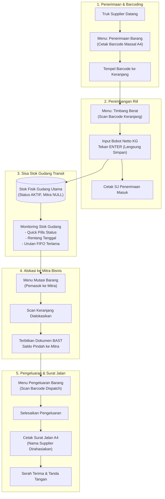

# 📘 PANDUAN LENGKAP ALUR OPERASIONAL END-TO-END (SOP)
## SISTEM BARCODE WAREHOUSE & DISTRIBUSI MULTI-MITRA (CATCH-WEIGHT)

> **Tujuan Dokumen:**  
> Panduan ini disusun untuk memberikan gambaran menyeluruh (*End-to-End*) tentang siklus operasional barang di gudang: mulai dari barang fisik tiba dari Pemasok/Nelayan, penimbangan riil (catch-weight), monitoring sisa stok gudang, mutasi alokasi kepemilikan ke Mitra Bisnis, hingga pengeluaran barang (*outbound dispatch*) dengan cetak Surat Jalan resmi tanpa mengekspos identitas supplier.

---

## 📑 DAFTAR ISI
1. [Konsep Dasar & Pihak yang Terlibat](#1-konsep-dasar--pihak-yang-terlibat)
2. [Diagram Alur End-to-End (Visual Workflow)](#2-diagram-alur-end-to-end-visual-workflow)
3. [Rincian 5 Tahapan Operasional Langkah-demi-Langkah](#3-rincian-5-tahapan-operasional-langkah-demi-langkah)
   - [Tahap 1: Penerimaan & Pembuatan Barcode Baru (Inbound)](#tahap-1-penerimaan--pembuatan-barcode-baru-inbound)
   - [Tahap 2: Stasiun Timbang Berat Riil (Catch-Weight Weighing)](#tahap-2-stasiun-timbang-berat-riil-catch-weight-weighing)
   - [Tahap 3: Monitoring & Filter Sisa Stok Gudang Utama (Transit Inventory)](#tahap-3-monitoring--filter-sisa-stok-gudang-utama-transit-inventory)
   - [Tahap 4: Mutasi & Alokasi Kepemilikan ke Mitra Bisnis](#tahap-4-mutasi--alokasi-kepemilikan-ke-mitra-bisnis)
   - [Tahap 5: Pengeluaran Barang (Outbound Dispatch) & Cetak Surat Jalan](#tahap-5-pengeluaran-barang-outbound-dispatch--cetak-surat-jalan)
4. [Matriks Status Barcode & Perubahan Kepemilikan](#4-matriks-status-barcode--perubahan-kepemilikan)
5. [Fitur-Fitur Khusus Gudang (Tips Cepat Operator)](#5-fitur-fitur-khusus-gudang-tips-cepat-operator)

---

## 1. KONSEP DASAR & PIHAK YANG TERLIBAT

Sistem ini memisahkan secara tegas antara **Pemasok Asal** dan **Mitra Bisnis Penerima**:

| Entitas | Peran dalam Sistem | Contoh di Sistem |
| :--- | :--- | :--- |
| **🚚 Pemasok (Supplier)** | Pihak yang menyuplai barang masuk (Nelayan, Tambak, Petani Ikan). Barang masuk dicatat dengan ID supplier ini. | `[KH-001] UDIN`, `[PMS-02] Tambak Bahari` |
| **🏢 Gudang Utama (Transit)** | Area fisik penerimaan awal. Barang yang baru ditimbang berstatus **Stok Gudang Utama** (belum dimiliki oleh mitra manapun). | Lokasi fisik gudang penerimaan / cold storage |
| **🏢 Mitra Bisnis (Partner)** | Rekanan bisnis / unit usaha (7 Mitra) yang akan menerima alokasi stok untuk didistribusikan atau dijual ke pasar. | `[M01] Mitra Bahari`, `[M02] Seafood Jaya` |
| **🛒 Pembeli / Konsumen** | Pembeli akhir yang menerima Surat Jalan Pengeluaran Barang. | Toko langganan, restoran, pasar retail |

---

---

## 2. DIAGRAM ALUR END-TO-END (VISUAL WORKFLOW)

### A. Diagram Visual (Langsung Terlihat di Semua Text Editor & Markdown Viewer)

```text
========================================================================================================
                               ALUR OPERASIONAL GUDANG & DISTRIBUSI (END-TO-END)
========================================================================================================

 [ TAHAP 1: PENERIMAAN ]          Truk Supplier Datang
                                            │
                                            ▼
                                  Buka Menu Penerimaan ───> [ 1. Buat & Cetak Barcode Baru ]
                                  (tab=massal)              (10 Stiker per Lembar A4)
                                            │
                                            ▼
                                  Tempel Stiker Barcode ke Keranjang Fisik
                                            │
────────────────────────────────────────────┼───────────────────────────────────────────────────────────
                                            ▼
 [ TAHAP 2: PENIMBANGAN ]         Bawa Keranjang ke Timbangan Digital
                                            │
                                            ▼
                                  Buka Stasiun Timbang ───> [ Scan Barcode Keranjang ]
                                  (tab=scantimbang)         [ Input Berat Netto KG   ]
                                                            [ Tekan ENTER (Langsung) ]
                                            │
                                            ▼
                                  Cetak SJ Penerimaan Masuk (Untuk Supplier)
                                            │
────────────────────────────────────────────┼───────────────────────────────────────────────────────────
                                            ▼
 [ TAHAP 3: STOK GUDANG ]         📦 STOK TRANSIT GUDANG UTAMA
                                  (Status = AKTIF, Mitra = Belum Terikat)
                                            │
                                            ▼
                                  Buka Menu Stok Gudang ──> [ Quick Pills: Perlu Ditimbang / Siap ]
                                  (tab=stok_gudang)         [ Filter Rentang Tanggal Mulai s/d Sampai ]
                                                            [ Urutan FIFO: Stok Terlama Keluar Dulu   ]
                                            │
────────────────────────────────────────────┼───────────────────────────────────────────────────────────
                                            ▼
 [ TAHAP 4: MUTASI / ALOKASI ]    Klik Tombol: [ Alokasi Mitra ]
                                            │
                                            ▼
                                  Buka Menu Mutasi ───────> [ Pilih: Pemasok Asal ➔ Mitra Tujuan ]
                                  (views/mutasi.php)        [ Scan Barcode Keranjang yang Dialokasi ]
                                                            [ Simpan Mutasi & Cetak BAST Resmi      ]
                                            │
                                            ▼
                                  🏢 Hak Stok Berpindah ke Saldo Mitra Tertentu
                                            │
────────────────────────────────────────────┼───────────────────────────────────────────────────────────
                                            ▼
 [ TAHAP 5: PENGELUARAN ]         Buka Pengeluaran Barang ─> [ Pilih Mitra & Driver/Kendaraan ]
                                  (views/pengeluaran.php)    [ Scan Barcode Keranjang Keluar  ]
                                                             [ Selesaikan Transaksi Dispatch  ]
                                            │
                                            ▼
                                  🖨️ CETAK SURAT JALAN PENGELUARAN (A4)
                                  (views/surat_jalan_print.php)
                                  ✓ Nama & Kode Pemasok BERSIH (Dirahasiakan dari Customer)
                                  ✓ Tercantum: No. SJ, Mitra Penerima, Item, Netto KG
                                  ✓ Tanda Tangan 3 Pihak: Gudang, Driver, Penerima
                                            │
                                            ▼
                                  [ SELESAI / BARANG DIKIRIM ]
========================================================================================================
```

### B. Diagram Alur Sistem (Mermaid Standard)



---

## 3. RINCIAN 5 TAHAPAN OPERASIONAL LANGKAH-DEMI-LANGKAH

### Tahap 1: Penerimaan & Pembuatan Barcode Baru (Inbound)
* **Kapan dilakukan?** Saat pasokan ikan/udang baru diturunkan dari kendaraan supplier/nelayan.
* **Halaman Web:** `index.php?page=timbang_cetak&tab=massal`
* **Langkah Kerja:**
  1. Operator memilih **Pemasok (Supplier)** asal pengiriman (misal: `KH-001 - UDIN`).
  2. Sistem otomatis membuat nomor Surat Jalan Inbound berurutan (`SJ-KH-001-YYMMDD-XXXX`).
  3. Operator memilih **Nama Barang / SKU Produk** (misal: `HRKK`, `Udang Vaname`, dll).
  4. Operator menentukan jumlah keranjang: tersedia tombol shortcut cepat `10 Pcs (1 Lembar)`, `20 Pcs (2 Lembar)`, `30 Pcs`, `50 Pcs`, atau ketik manual.
  5. Klik tombol **Cetak Barcode Baru**.
  6. Dokumen lembar A4 (grid 2 kolom × 5 baris = 10 stiker/lembar) siap dicetak.
  7. Petugas menempelkan stiker barcode ke masing-masing keranjang kosong/wadah ikan.

---

### Tahap 2: Stasiun Timbang Berat Riil (Catch-Weight Weighing)
* **Kapan dilakukan?** Sesaat setelah stiker ditempelkan pada keranjang berisi ikan.
* **Halaman Web:** `index.php?page=timbang_cetak&tab=scantimbang`
* **Langkah Kerja:**
  1. Letakkan keranjang di atas timbangan digital.
  2. Arahkan *barcode scanner gun* ke stiker barcode di keranjang.
  3. Sistem langsung mengenali data barang, pemasok, dan nomor surat jalan.
  4. Masukkan angka timbangan riil (Netto KG), atau angka otomatis tertarik dari timbangan digital.
  5. Tekan tombol **ENTER** pada keyboard:
     * Berat langsung tersimpan ke database.
     * Suara *beep* berbunyi menandakan sukses.
     * Keranjang masuk ke riwayat penimbangan sesi di sebelah kanan.
     * **Tidak ada dialog printer pop-up** sehingga proses timbang puluhan keranjang berjalan cepat.
  6. Jika supplier memerlukan bukti penerimaan, klik **Cetak Surat Jalan Penerimaan Masuk** (`views/surat_jalan_penerimaan_print.php`).

---

### Tahap 3: Monitoring & Filter Sisa Stok Gudang Utama (Transit Inventory)
* **Kapan dilakukan?** Oleh Kepala Gudang / Admin untuk memantau sisa stok fisik yang masih ada di gudang sebelum dimutasikan.
* **Halaman Web:** `index.php?page=timbang_cetak&tab=stok_gudang`
* **Fitur Utama Filter Propper:**
  1. **Quick Filter Pills (1-Klik):**
     * `Semua Stok`: Melihat seluruh keranjang di gudang.
     * `⏳ Perlu Ditimbang`: Menyaring keranjang yang bobotnya masih 0 KG (butuh ditimbang).
     * `✓ Siap Alokasi`: Menyaring keranjang yang sudah ada bobotnya (> 0 KG) dan siap dimutasikan.
     * `📅 Masuk Hari Ini`: Menyaring pasokan yang baru tiba hari ini.
     * `⚠️ Mengendap > 3 Hari`: *Aging alert* untuk mendeteksi ikan lama agar tidak rusak.
  2. **Filter Rentang Tanggal Langsung (Dual Date Picker):**
     * `Mulai Dari [Tanggal]` s/d `Sampai [Tanggal]` langsung tampak di layar tanpa tersembunyi.
     * Disertai tombol preset instan: `Hari Ini`, `Kemarin`, `7 Hari`, `Bulan Ini`, dan tombol hapus `✕`.
  3. **Dropdown Dinamis:**
     * Filter Pemasok, Kategori, Produk (otomatis tersinkron dengan kategori yang dipilih), Status Timbang.
     * **Urutan (Sorting):**
       * `⚡ Total Berat (KG Terbanyak)`
       * `⏱️ FIFO: Masuk Terlama (Dahulukan Alokasi)` &rarr; *Mencegah ikan lama membusuk*
       * `🆕 Masuk Terbaru (LIFO)`
       * `📦 Keranjang Terbanyak`
       * `🔤 Nama Produk (A - Z)`
  4. **Dua Mode Tampilan:**
     * **Tab Rekapitulasi per Produk & Pemasok**: Ringkasan jumlah keranjang, total KG, rata-rata KG/pcs, dan status kesiapan.
     * **Tab Rincian Stiker Barcode Satuan**: Daftar detail per stiker individual lengkap dengan pagination.

---

### Tahap 4: Mutasi & Alokasi Kepemilikan ke Mitra Bisnis
* **Kapan dilakukan?** Saat stok fisik di gudang utama diputuskan untuk diserahkan/dimutasikan ke salah satu dari 7 Mitra Bisnis.
* **Halaman Web:** `index.php?page=mutasi&alur=PEMASOK_KE_MITRA`
* **Langkah Kerja:**
  1. Klik tombol **Alokasi Mitra** langsung dari tabel Stok Gudang (atau buka menu Mutasi).
  2. Pilih jenis alur: **Alokasi Stok: Pemasok ➔ Mitra Bisnis**.
  3. Pilih **Pemasok Asal** dan tentukan **Mitra Bisnis Penerima** (misal: `[M01] Mitra Bahari`).
  4. Isi nama petugas penyerah dan penerima untuk dokumen BAST.
  5. Scan barcode keranjang-keranjang yang akan diserahkan.
  6. Klik tombol simpan mutasi:
     * Status barcode di database terikat ke `mitra_id`.
     * Saldo fisik berpindah dari gudang utama ke saldo mitra.
     * Terbit dokumen resmi Berita Acara Serah Terima (BAST).

---

### Tahap 5: Pengeluaran Barang (Outbound Dispatch) & Cetak Surat Jalan
* **Kapan dilakukan?** Saat barang pesanan dikeluarkan dari gudang untuk dikirimkan ke pembeli/pelanggan.
* **Halaman Web:** `index.php?page=pengeluaran`
* **Langkah Kerja:**
  1. Pilih **Pemasok Asal Stok** dan **Mitra Penerima**.
  2. Masukkan nama Driver / Pembawa Kendaraan dan nomor polisi kendaraan.
  3. Scan barcode keranjang yang akan dimuat ke kendaraan.
  4. Klik **Selesaikan Pengeluaran Barang**:
     * Status barcode berubah dari `AKTIF` menjadi `KELUAR`.
     * Transaksi pengeluaran tercatat rapi di histori.
  5. Klik tombol **Cetak Surat Jalan (A4)**:
     * Membuka dokumen cetak `views/surat_jalan_print.php`.
     * **🛡️ Fitur Perlindungan Bisnis (Kerahasiaan Supplier):**
       * Seluruh nama dan kode pemasok asal **dihilangkan dari dokumen cetak**.
       * Kolom asal hanya mencantumkan *Asal Pengeluaran: Gudang Logistik Utama*.
       * Tabel nama ikan bersih tanpa teks nama pemasok.
       * Pelanggan/pembeli tidak akan mengetahui identitas nelayan/supplier asal barang.
  6. Dokumen ditandatangani oleh 3 pihak: Petugas Gudang, Sopir Ekspedisi, dan Penerima Barang.

---

## 4. MATRIKS STATUS BARCODE & PERUBAHAN KEPEMILIKAN

| Tahapan Operasional | Status di Database (`labels.status`) | Kepemilikan Mitra (`labels.mitra_id`) | Berat Netto (`labels.berat_netto`) | Posisi Barang Fisik |
| :--- | :--- | :--- | :--- | :--- |
| **1. Baru Cetak Barcode** | `AKTIF` | `NULL` | `0.00 KG` | Keranjang kosong baru ditempel stiker |
| **2. Selesai Timbang** | `AKTIF` | `NULL` | `> 0.00 KG` (Riil) | Gudang Transit Utama |
| **3. Selesai Mutasi/Alokasi** | `AKTIF` | Terisi ID Mitra (`1` s/d `7`) | Tetap | Milik Mitra (Di Cold Storage) |
| **4. Pengeluaran (Outbound)** | `KELUAR` | Terisi ID Mitra | Tetap | Dalam Pengiriman ke Pembeli |

---

## 5. FITUR-FITUR KHUSUS GUDANG (TIPS CEPAT OPERATOR)

1. **Cetak Ulang 1 Barcode Rusak Menjadi 1 Lembar Penuh (10 Barcode Kembar):**
   * Jika ada stiker barcode yang robek atau basah, klik tombol rincian barcode &rarr; klik ikon printer &rarr; pilih **"📄 Cetak 1 Lembar Penuh (10 Pcs Barcode Ini)"**.
   * Printer akan mencetak 10 stiker dengan nomor yang sama di 1 lembar A4 tanpa membuang-buang kertas stiker.
2. **Cetak Cerdas Sisa Barcode (Anti Cetak Ganda):**
   * Jika dari 10 keranjang baru 4 yang ditimbang, tombol cetak otomatis berubah menjadi **`🖨️ Cetak Sisa (6 Pcs)`**. Sistem tidak akan mencetak ulang 4 barcode yang sudah ditimbang, sehingga tidak ada stiker tertempel ganda.
3. **Pencarian Multifungsi:**
   * Kolom pencarian di stok gudang dapat membaca:
     - Nomor barcode (`KH001-UD01-...`)
     - Nomor surat jalan (`SJ-...`)
     - Nama ikan (`Gabus`, `HRKK`, `Udang`)
     - Kode produk maupun nama pemasok.
