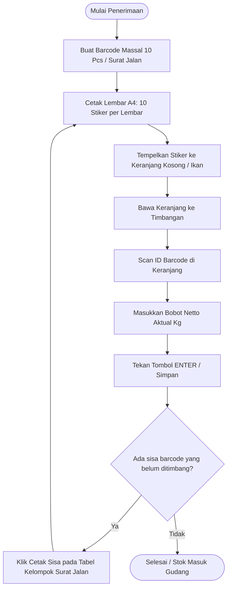

# DOKUMENTASI SISTEM: PENGELOMPOKAN & CETAK BARCODE GUDANG (A4 & THERMAL)

> **Sistem Barcode Inventory Multi-Mitra (Catch-Weight Architecture)**  
> **Versi Rilis Fitur:** v2.4 (Batch Grouping, Anti-Double Print, Full-Width Barcode & Instant Weighing)  
> **Terakhir Diperbarui:** 23 Oktober 2026  

---

## 📑 DAFTAR ISI
1. [Ringkasan Eksekutif](#1-ringkasan-eksekutif)
2. [Fitur-Fitur Utama](#2-fitur-fitur-utama)
   - [2.1 Pengelompokan Data Barcode (Batch Grouping per Surat Jalan)](#21-pengelompokan-data-barcode-batch-grouping-per-surat-jalan)
   - [2.2 Cetak Ulang 1 Pcs Menjadi 1 Lembar Penuh (10 Barcode Kembar)](#22-cetak-ulang-1-pcs-menjadi-1-lembar-penuh-10-barcode-kembar)
   - [2.3 Cetak Cerdas Sisa Barcode (Anti Cetak Ganda)](#23-cetak-cerdas-sisa-barcode-anti-cetak-ganda)
   - [2.4 Batang Barcode Full-Width & Tanpa QRCode](#24-batang-barcode-full-width--tanpa-qrcode)
   - [2.5 Alur Penimbangan Instan (Enter Langsung Simpan)](#25-alur-penimbangan-instan-enter-langsung-simpan)
   - [2.6 Tampilan Layar Bersih (Zero Screen Glitch)](#26-tampilan-layar-bersih-zero-screen-glitch)
3. [Panduan Operasional Operator Gudang](#3-panduan-operasional-operator-gudang)
4. [Rincian Teknis & Arsitektur Kode](#4-rincian-teknis--arsitektur-kode)
5. [Spesifikasi Layout Cetak Lembar A4](#5-spesifikasi-layout-cetak-lembar-a4)
6. [Riwayat Perbaikan Bug (Changelog)](#6-riwayat-perbaikan-bug-changelog)

---

## 1. RINGKASAN EKSEKUTIF

Dokumen ini menjelaskan pembaharuan menyeluruh pada modul **Penerimaan (Timbang & Cetak)** dalam Sistem Barcode Inventory Multi-Mitra. Pembaharuan ini difokuskan pada peningkatan efisiensi operasional pergudangan, kecepatan kerja operator timbangan, kejelasan visual barcode untuk alat pemindai fisik (*barcode scanner gun*), serta pencegahan pemborosan kertas dan stiker stiker ganda.

---

## 2. FITUR-FITUR UTAMA

### 2.1 Pengelompokan Data Barcode (Batch Grouping per Surat Jalan)
* Pada tabel **Daftar Seluruh Penerimaan Barang Masuk**, data sekarang disajikan dalam mode **📦 Per Kelompok Batch** secara default.
* Setiap baris kelompok merangkum informasi:
  - **No. Surat Jalan & Waktu Penerimaan**
  - **Mitra Bisnis Pemilik & Nama Produk SKU**
  - **Total Barcode & Kebutuhan Lembar A4** (Contoh: `10 Pcs (1 Lembar A4)`)
  - **Status Penimbangan** (Jumlah stiker yang masih `⚠ Belum Ditimbang` atau `✓ Lengkap`)
  - **Rentang ID Barcode** (ID awal s/d ID akhir)
  - **Aksi Cepat Cetak & Accordion Rincian**
* Operator dapat beralih antara tampilan **Per Kelompok Batch** dan **Rincian Barcode Satuan** kapan saja melalui tombol *switch view*.

---

### 2.2 Cetak Ulang 1 Pcs Menjadi 1 Lembar Penuh (10 Barcode Kembar)
* Jika operator memerlukan stiker tambahan untuk 1 unit tertentu (misalnya stiker rusak, robek, atau kemasan perlu penandaan ekstra):
* Mengklik ikon printer **🖨️** pada barcode tersebut akan memunculkan modal dialog **"Opsi Cetak Ulang Barcode"**.
* **Pilihan Tersedia:**
  1. **📄 Cetak 1 Lembar Penuh (10 Pcs Barcode Ini)**:
     - Sistem menduplikasikan 1 ID barcode tersebut ke dalam **10 slot stiker kembar** yang memenuhi 1 lembar A4 penuh (grid 2 kolom × 5 baris).
     - Bebas halaman kosong (*zero blank page*).
  2. **📦 Cetak Sisa Barcode di Surat Jalan Ini**:
     - Mencetak barcode dalam surat jalan yang sama (khusus yang belum ditimbang).
  3. **🏷️ Cetak Satuan Saja (Thermal Roll 100×50 mm)**:
     - Mencetak hanya 1 stiker tunggal untuk printer thermal roll.

---

### 2.3 Cetak Cerdas Sisa Barcode (Anti Cetak Ganda)
* **Kasus Lapangan**: Dalam 1 surat jalan berisi 10 keranjang (10 barcode), 4 keranjang telah ditimbang bobotnya dan ditempelkan, sementara 6 keranjang lainnya baru akan dicetak stikernya.
* **Mekanisme Otomatis**:
  - Tombol aksi pada tabel kelompok otomatis mendeteksi status sisa dan berubah menjadi:
    **`🖨️ Cetak Sisa (6 Pcs)`**
  - Saat tombol ini diklik, sistem **hanya mengambil dan mencetak 6 barcode yang belum ditimbang**.
  - Barcode yang sudah ditimbang **tidak akan dicetak ulang**, sehingga mencegah kekeliruan penempelan stiker ganda di lapangan.
  - Jika seluruh 10 barcode telah selesai ditimbang, tombol berubah menjadi **`Cetak Ulang (10 Pcs)`**.

---

### 2.4 Batang Barcode Full-Width & Tanpa QRCode
* **Penyesuaian Visual**: Seluruh QRCode telah dihilangkan dari seluruh template cetakan stiker kemasan.
* **Keuntungan Teknis**:
  - Seluruh lebar stiker (100% *full-width*) sekarang dialokasikan penuh untuk **Batang Barcode Code 128**.
  - Batang barcode menjadi jauh lebih tinggi (**20 mm**), garis modul bar hitam lebih tebal dan renggang (**1.6 modul**).
  - Menggunakan rendering tepi tajam (*crispEdges*) dan *preserveAspectRatio="none"*, sehingga barcode dapat dibaca sangat cepat oleh laser scanner dari sudut miring atau jarak jauh tanpa gagal baca.
  - Teks nomor ID Barcode ditempatkan di tengah (*center aligned*) dengan font tebal (*font-weight: 900*).

---

### 2.5 Alur Penimbangan Instan (Enter Langsung Simpan)
* **Kecepatan Operator**:
  - Saat menimbang keranjang pada menu **Scan Barcode & Timbang Berat**, operator cukup memasukkan angka timbangan lalu menekan tombol **Enter** pada keyboard (atau klik tombol **"💾 Simpan Berat Riil"**).
  - Sistem langsung menyimpan bobot ke database, memutar suara *beep* sukses, memasukkan data ke tabel riwayat sesi di sebelah kanan, dan mereset form untuk siap scan berikutnya.
  - **Tidak ada pop-up dialog cetak yang mengganggu alur penimbangan cepat.**
  - Jika sewaktu-waktu membutuhkan cetak ulang untuk label yang baru ditimbang, tombol **🖨️ Cetak** tetap tersedia di samping riwayat sesi.

---

### 2.6 Tampilan Layar Bersih (Zero Screen Glitch)
* Wadah cetak `#bulkPrintContainer` kini dikunci dengan aturan CSS:
  ```css
  #bulkPrintContainer, .print-area {
      display: none !important;
      visibility: hidden !important;
      height: 0 !important;
      overflow: hidden !important;
  }
  ```
* Wadah cetak hanya aktif secara internal di render tree printer saat `@media print` dipanggil.
* Tidak ada lagi batang barcode raksasa yang tumpah atau merusak tampilan monitor desktop.

---

## 3. PANDUAN OPERASIONAL OPERATOR GUDANG



### Langkah Kerja Harian:
1. **Pembuatan Barcode Massal**:
   - Masuk ke menu **Penerimaan (Timbang & Cetak)** -> Tab **Buat Barcode Massal (Tanpa Berat)**.
   - Pilih Mitra, Surat Jalan, Produk, dan Jumlah Barcode (misal 10 pcs).
   - Klik **⚡ Buat Barcode Massal & Siapkan Lembar Cetak**.
   - Cetak lembar A4 (1 lembar memuat 10 stiker barcode).
2. **Penimbangan Barang (Catch-Weight)**:
   - Masuk ke tab **Scan Barcode & Timbang Berat**.
   - Arahkan scanner ke barcode keranjang.
   - Timbangan akan mengisi angka berat (atau ketik manual), lalu tekan **Enter**.
   - Bobot langsung tersimpan tanpa gangguan jendela print.
3. **Cetak Ulang Jika Rusak**:
   - Buka tabel kelompok di bawah, klik tombol **Rincian**.
   - Klik ikon **🖨️** pada barcode yang ingin dicetak ulang.
   - Pilih opsi **"Cetak 1 Lembar Penuh (10 Pcs Barcode Ini)"** untuk mencetak 1 lembar A4 penuh berisi 10 stiker barcode kembar.

---

## 4. RINCIAN TEKNIS & ARSITEKTUR KODE

### File-File yang Dimodifikasi:

| File | Lokasi | Perubahan Utama |
| :--- | :--- | :--- |
| **`Label.php`** | `app/Models/Label.php` | - `getGroupedPenerimaan()`: Grouping batch per Surat Jalan.<br>- `getBySuratJalan($noSj, $status)`: Filter cerdas sisa barcode belum ditimbang.<br>- `getSingleDuplicate10($barcode)`: Duplikasi 10 stiker kembar untuk 1 lembar A4.<br>- `getRecent($limit)`: Query data label terakhir untuk widget dashboard. |
| **`BarcodeService.php`** | `app/Services/BarcodeService.php` | - Meningkatkan tinggi barcode Code 128 menjadi 65px dan ketebalan modul garis menjadi 1.6.<br>- Menambahkan `preserveAspectRatio="none"` dan `shape-rendering="crispEdges"`. |
| **`index.php`** | Root `/index.php` | - Routing API `get_labels_for_reprint` mendukung parameter `type` (`single_duplicate_10`, `group_sj`, `selected_ids`) dan parameter `status` (`auto_unweighed`, `unweighed`, `all`). |
| **`timbang_cetak.php`** | `views/timbang_cetak.php` | - Tabel kelompok batch dan switch mode tampilan.<br>- Modal pilihan cetak `#modalReprintChoice`.<br>- Penghapusan elemen QRCode dan pemaksimalan lebar batang barcode.<br>- Nonaktifkan auto-print setelah enter pada penimbangan. |
| **`print-label.css`** | `assets/css/print-label.css` | - Proteksi penyembunyian `#bulkPrintContainer` di layar monitor biasa.<br>- Aturan cetak full-width barcode tanpa QRCode.<br>- Garis batas potong 1/2 lembar A4 (untuk 5 pcs). |

---

## 5. SPESIFIKASI LAYOUT CETAK LEMBAR A4

* **Ukuran Media**: Standar A4 Portrait (`210 mm × 297 mm`).
* **Margin Cetak**: `5 mm` atas/bawah, `6 mm` kiri/kanan.
* **Format Grid Lembar**: 2 Kolom × 5 Baris (Kapasitas tepat **10 stiker per lembar**).
* **Dimensi Setiap Kartu Stiker**:
  - Lebar: `97 mm`
  - Tinggi: `50.5 mm` (Sesuai proporsi stiker label industri logistik).
* **Dimensi Batang Barcode (Code 128)**:
  - Lebar: `100%` lebar dalam stiker (~`90 mm`).
  - Tinggi: `20 mm`.
* **Kerapian Halaman**:
  - Menggunakan `page-break-after: always` hanya di antara lembar, dan `page-break-after: avoid` pada lembar terakhir.
  - Dijamin **0 halaman kosong (Zero Blank Page)** baik pada 5 pcs (1/2 lembar), 10 pcs (1 lembar), maupun kelipatannya (20 pcs, 30 pcs, dst).

---

## 6. RIWAYAT PERBAIKAN BUG (CHANGELOG)

### Versi 2.6.1 (24 Oktober 2026)
* **Fix Cetak Barcode Blank Putih (Zero Blank Print Guarantee)**:
  - Mengatasi masalah pratinjau cetak printer (Epson L3210/A4/Thermal) yang menghasilkan lembar kosong putih.
  - Menghapus atribut inline `style="display: none !important;"` pada elemen `#bulkPrintContainer` yang sebelumnya menimpa dan mematikan perintah cetak `@media print`.
  - Mengunci penyembunyian wadah cetak hanya pada `@media screen` (layar desktop), dan secara otomatis mengaktifkan rendering stiker barcode saat `@media print` dipicu oleh browser.
  - Memperbaiki pemanggilan cetak label tunggal pada tombol "Simpan & Cetak Label" agar langsung memuat data label ke kontainer cetak.

### Versi 2.6 (24 Oktober 2026)
* **Penghapusan Master Lokasi Gudang (Penyederhanaan Arsitektur ke 7 Mitra Bisnis)**:
  - Master lokasi gudang (`gudang_lokasi`) dihapus dan dinonaktifkan total dari seluruh modul sistem (Master Data, Penerimaan, Pemindahan Stok, Pengeluaran, dan Stok Opname).
  - Seluruh kepemilikan dan penyimpanan fisik kini 100% mengacu pada **Mitra Bisnis** (7 Mitra) yang masing-masing telah terintegrasi dengan kode gudang Accurate Online.
  - Foreign key constraint ke `gudang_lokasi` berhasil di-drop dan digantikan dengan relasi langsung ke entitas Mitra dan Pemasok.
* **Log Alur Siklus Hidup Stok (End-to-End Lifecycle Barcode Tracker)**:
  - **Banner Visual 3 Tahap Alur**:
    1. **Tahap 1 (Inbound)**: Diterima dari Pemasok (Nelayan / Supplier) dengan No. Surat Jalan Pemasok.
    2. **Tahap 2 (Transfer / Alokasi)**: Pemindahan Stok dari Pemasok ke Mitra Bisnis (atau Transfer Antar-Mitra) dengan Berita Acara Serah Terima (BAST).
    3. **Tahap 3 (Outbound)**: Pengeluaran Barang dari Mitra ke Pembeli / POS dengan Surat Jalan Pengiriman (DO).
  - **Formulir Pemindahan Stok Modern**:
    - Pilihan jenis alur: Alokasi Pemasok ➔ Mitra, Transfer Antar-Mitra, dan Pengeluaran ke Pembeli POS.
    - Validasi otomatis pihak serah terima (Penyerah & Penerima) yang terikat langsung ke akun user login.
    - Scanner barcode responsif dengan peringatan instan jika kemasan sudah keluar atau tidak sesuai kepemilikan.
  - **Tabel Log Alur Pergerakan Stok (Lifecycle Tracker)**:
    - Menampilkan seluruh kemasan barcode lengkap dengan Pemasok Asal, No. Surat Jalan, Mitra Pemilik Saat Ini, Berat Netto, dan Status Tahap Alur (Tahap 1 / 2 / 3).
    - Tombol **🔍 Lihat Alur** pada setiap baris kemasan yang memunculkan modal dialog **Timeline Alur Perjalanan Barcode** dengan riwayat vertikal kronologis.

### Versi 2.5 (24 Oktober 2026)
* **Filter Stock Opname Multi-Parameter**: Menambahkan filter terintegrasi pada tabel *Daftar Barang Belum Keluar (Fisik di Gudang)* di menu Stock Opname (`stok_opname`):
  - **Filter Mitra Bisnis**: Membatasi audit fisik per mitra pemilik barang.
  - **Filter No. Surat Jalan**: Memfilter fisik barang berdasarkan nomor surat jalan tertentu dilengkapi auto-complete *datalist* dari nomor surat jalan aktif di gudang.
  - **Filter Lokasi Gudang**: Memfokuskan pencocokan fisik pada rak/ruang pendingin tertentu.
  - **Pencarian Bebas**: Pencarian instan berdasarkan kode barcode, nama produk, nomor surat jalan, hingga kode mitra/pemasok.
  - **Sinkronisasi Sesi Scanner**: Form filter pada card scanner dan tabel utama tersinkronisasi secara otomatis.

### Versi 2.4 (23 Oktober 2026)
* **Fix Call to undefined method `Label::getRecent()`**: Mengembalikan method `getRecent()` di model `Label` untuk mendukung widget dashboard utama, mutasi barang, dan pengeluaran.
* **Fix Pop-up "Gagal mengambil data barcode: Terjadi kesalahan"**: Memperbaiki pembacaan parameter `ids` dan `barcodes` pada controller `index.php` saat penimbangan berlangsung.
* **Fix Batang Barcode Raksasa di Layar**: Mengunci wadah `#bulkPrintContainer` dengan `display: none !important` di mode monitor desktop biasa.
* **Remove QRCode**: Menghilangkan seluruh elemen QRCode dari kartu stiker barcode untuk memaksimalkan panjang dan keterbacaan batang barcode laser.
* **Anti-Double Printing**: Tombol cetak kelompok surat jalan kini memfilter otomatis hanya barcode yang berstatus belum ditimbang.
