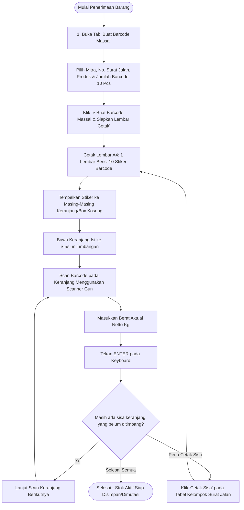

# 📘 DOKUMENTASI SISTEM & PANDUAN OPERASIONAL
# SISTEM BARCODE INVENTORY MULTI-MITRA (CATCH-WEIGHT)

> **Warehouse Execution System (WES) & Catch-Weight Management**  
> **Versi Rilis:** v2.4 (Batch Grouping, Anti-Double Print, Full-Width Barcode & Instant Weighing)  
> **Terakhir Diperbarui:** 23 Oktober 2026  
> **Lingkungan Operasional:** XAMPP (Apache + MySQL + PHP 8.2), Windows  
> **Alamat Web:** `http://localhost/project/`

---

## 📑 DAFTAR ISI
1. [Ringkasan Eksekutif](#1-ringkasan-eksekutif)
2. [Fitur-Fitur Utama & Pembaruan Sistem](#2-fitur-fitur-utama--pembaruan-sistem)
   - [2.1 Pengelompokan Data Barcode (Batch Grouping per Surat Jalan)](#21-pengelompokan-data-barcode-batch-grouping-per-surat-jalan)
   - [2.2 Cetak Ulang 1 Pcs Menjadi 1 Lembar Penuh (10 Barcode Kembar)](#22-cetak-ulang-1-pcs-menjadi-1-lembar-penuh-10-barcode-kembar)
   - [2.3 Cetak Cerdas Sisa Barcode (Anti Cetak Ganda)](#23-cetak-cerdas-sisa-barcode-anti-cetak-ganda)
   - [2.4 Batang Barcode Full-Width & Tanpa QRCode](#24-batang-barcode-full-width--tanpa-qrcode)
   - [2.5 Alur Penimbangan Instan (Enter Langsung Simpan)](#25-alur-penimbangan-instan-enter-langsung-simpan)
   - [2.6 Tampilan Layar Bersih (Zero Screen Glitch)](#26-tampilan-layar-bersih-zero-screen-glitch)
3. [Standar Operasional Prosedur (SOP) Operator Gudang](#3-standar-operasional-prosedur-sop-operator-gudang)
4. [Spesifikasi Layout & Format Cetak Lembar A4](#4-spesifikasi-layout--format-cetak-lembar-a4)
5. [Arsitektur Kode & Rincian File](#5-arsitektur-kode--rincian-file)
6. [Dokumentasi API & Endpoint Cetak](#6-dokumentasi-api--endpoint-cetak)
7. [Panduan Pemecahan Masalah (Troubleshooting & FAQs)](#7-panduan-pemecahan-masalah-troubleshooting--faqs)
8. [Petunjuk Instalasi & Menjalankan di XAMPP](#8-petunjuk-instalasi--menjalankan-di-xampp)

---

## 1. RINGKASAN EKSEKUTIF

Sistem Barcode Inventory Multi-Mitra dirancang khusus untuk mengelola barang pergudangan dengan karakteristik **bobot bervariasi (*catch-weight*)** milik **7 Mitra Bisnis**. Setiap kemasan fisik (seperti keranjang ikan, udang, atau box beku) ditempelkan label barcode unik yang memuat identitas mitra, jenis barang, nomor surat jalan, dan berat riil (*netto*).

Pembaruan pada **Versi 2.4** menghadirkan efisiensi operasional tingkat tinggi:
* **Pengelompokan Otomatis**: Data penerimaan ratusan barcode kini dikelompokkan rapi per nomor Surat Jalan.
* **Format Cetak Presisi**: Cetak massal pada kertas A4 (10 barcode/lembar) dan 5 barcode (1/2 lembar) tanpa halaman kosong (*zero blank page*).
* **Solusi Stiker Rusak**: Kemampuan mencetak ulang 1 nomor barcode menjadi 1 lembar penuh (10 stiker kembar).
* **Scanner-Friendly**: Batang barcode Code 128 diperbesar penuh (*full-width*) dan QRCode dihilangkan untuk akselerasi scanning fisik laser.
* **Anti-Human Error**: Tombol cetak sisa otomatis menyaring hanya barcode yang belum ditimbang, mencegah pencetakan ganda di lapangan.
* **Penimbangan Cepat**: Tombol Enter pada stasiun timbang langsung menyimpan data tanpa memunculkan dialog cetak yang menghambat kerja.

---

## 2. FITUR-FITUR UTAMA & PEMBARUAN SISTEM

### 2.1 Pengelompokan Data Barcode (Batch Grouping per Surat Jalan)
* Pada tabel **Daftar Seluruh Penerimaan Barang Masuk**, data ditampilkan dalam mode **📦 Per Kelompok Batch** secara default.
* Informasi dalam satu baris kelompok:
  - **No. Surat Jalan & Waktu Penerimaan**
  - **Mitra Bisnis Pemilik & Nama Produk SKU**
  - **Total Barcode & Kebutuhan Lembar A4** (Contoh: `10 Pcs (1 Lembar A4)`)
  - **Status Penimbangan** (Indikator `⚠ Belum Ditimbang` vs `✓ Lengkap`)
  - **Rentang ID Barcode** (ID awal s/d ID akhir)
  - **Tombol Aksi Cerdas** (`Cetak Sisa`, `Cetak Ulang`, `Rincian`)
* Operator dapat berganti ke tampilan **Rincian Barcode Satuan** kapan saja melalui tombol *switch view*.

---

### 2.2 Cetak Ulang 1 Pcs Menjadi 1 Lembar Penuh (10 Barcode Kembar)
* Sering terjadi di lapangan di mana stiker barcode basah, rusak, robek, atau keranjang membutuhkan penandaan stiker di beberapa sisi.
* Saat operator mengklik ikon printer **🖨️** pada salah satu baris rincian barcode, modal interaktif **"Opsi Cetak Ulang Barcode"** akan muncul dengan 3 opsi:
  1. **📄 Cetak 1 Lembar Penuh (10 Pcs Barcode Ini)**:
     - Sistem menduplikasikan data barcode tunggal tersebut menjadi **10 slot stiker kembar identik** dalam 1 lembar A4 (grid 2 kolom × 5 baris).
     - Menghilangkan pemborosan kertas stiker A4.
  2. **📦 Cetak Sisa Barcode di Surat Jalan Ini**:
     - Mencetak seluruh barcode lain dalam surat jalan yang sama yang belum ditimbang.
  3. **🏷️ Cetak Satuan Saja (Thermal Roll 100×50 mm)**:
     - Cetak 1 stiker tunggal untuk printer thermal gulung.

---

### 2.3 Cetak Cerdas Sisa Barcode (Anti Cetak Ganda)
* **Masalah Lapangan**: Pada 1 Surat Jalan berisi 10 keranjang (10 barcode), misal 4 keranjang sudah ditimbang dan ditempel, lalu printer macet atau operator butuh mencetak sisa barcode. Jika dicetak ulang seluruhnya (10 pcs), 4 barcode lama berisiko tertempel dua kali ke keranjang lain dan menyebabkan kekacauan stok.
* **Mekanisme Otomatis**:
  - Sistem mendeteksi status timbang: jika ada 4 yang sudah ditimbang dan 6 belum, tombol aksi otomatis berlabel:
    **`🖨️ Cetak Sisa (6 Pcs)`**
  - Saat diklik, sistem **hanya memuat 6 barcode yang belum ditimbang** (`berat_netto <= 0`).
  - Barcode yang sudah ditimbang **dikecualikan dari cetakan**.
  - Jika seluruh 10 barcode telah selesai ditimbang, tombol berubah menjadi **`Cetak Ulang (10 Pcs)`**.

---

### 2.4 Batang Barcode Full-Width & Tanpa QRCode
* Seluruh elemen QRCode telah dihilangkan dari seluruh template stiker kemasan barcode penerimaan.
* **Keunggulan Teknis**:
  - Batang barcode Code 128 mengisi **100% lebar stiker** (~90 mm).
  - Ketinggian batang ditingkatkan menjadi **20 mm** dengan ketebalan modul **1.6**.
  - Dilengkapi atribut SVG `preserveAspectRatio="none"` dan CSS `shape-rendering: crispEdges;`, memastikan garis hitam barcode sangat tajam dan tidak kabur.
  - Sangat mudah dan responsif dibaca oleh *barcode scanner laser / CCD gun* fisik dari jarak jauh maupun sudut kemiringan ekstrem.

---

### 2.5 Alur Penimbangan Instan (Enter Langsung Simpan)
* Di stasiun timbangan (**Scan Barcode & Timbang Berat**):
  - Operator men-scan nomor label keranjang, lalu menginput bobot riil (atau otomatis dari timbangan digital).
  - Operator cukup menekan tombol **Enter** pada keyboard (atau klik tombol **"💾 Simpan Berat Riil"**).
  - Bobot langsung tersimpan ke database, berbunyi *beep* sukses, masuk ke riwayat penimbangan sesi, dan form langsung siap menerima scan berikutnya.
  - **Dialog jendela cetak printer tidak akan muncul otomatis**, sehingga proses penimbangan puluhan keranjang berjalan sangat cepat tanpa interupsi.
  - Tombol cetak manual tetap disediakan di samping riwayat jika operator ingin mencetak ulang label satuan.

---

### 2.6 Tampilan Layar Bersih (Zero Screen Glitch)
* Wadah cetak `#bulkPrintContainer` dikunci dengan aturan CSS:
  ```css
  #bulkPrintContainer, .print-area {
      display: none !important;
      visibility: hidden !important;
      height: 0 !important;
      overflow: hidden !important;
  }
  ```
* Wadah cetak hanya aktif secara internal pada render tree printer saat `@media print` dieksekusi.
* Tampilan monitor komputer desktop tetap rapi dan bersih tanpa adanya batang barcode raksasa yang tumpah ke layar.

---

## 3. STANDAR OPERASIONAL PROSEDUR (SOP) OPERATOR GUDANG

Berikut diagram alur operasional penerimaan dan penimbangan barang masuk di gudang:



### Petunjuk Langkah Demi Langkah:
1. **Membuat Barcode Penerimaan**:
   - Akses menu: **Penerimaan (Timbang & Cetak)** -> Tab **Buat Barcode Massal (Tanpa Berat)**.
   - Pilih **Mitra Bisnis**, masukkan **Nomor Surat Jalan**, pilih **Nama Produk**, dan tentukan **Jumlah Barcode** (misal: 10).
   - Klik tombol **⚡ Buat Barcode Massal & Siapkan Lembar Cetak**.
   - Jendela print preview akan muncul. Pastikan memilih ukuran kertas **A4**, Margin **None / Default**, lalu klik **Print**.
2. **Menimbang Berat Riil (Catch-Weight)**:
   - Akses tab **Scan Barcode & Timbang Berat**.
   - Arahkan scanner laser ke barcode yang tertera pada keranjang. Data produk dan surat jalan akan otomatis terisi.
   - Masukkan bobot timbangan aktual (kg) pada kolom **Berat Netto (Kg)**.
   - Tekan tombol **ENTER** di keyboard. Data tersimpan dalam hitungan milidetik.
3. **Mencetak Ulang 1 Barcode Rusak Menjadi 1 Lembar Penuh**:
   - Pada tabel kelompok di bawah, klik tombol **Rincian**.
   - Cari nomor barcode yang ingin dicetak ulang, klik ikon printer **🖨️**.
   - Pilih menu **"📄 Cetak 1 Lembar Penuh (10 Pcs Barcode Ini)"**.
   - Printer akan mencetak 1 lembar A4 penuh berisi 10 stiker dengan kode yang sama.

---

## 4. SPESIFIKASI LAYOUT & FORMAT CETAK LEMBAR A4

| Parameter | Spesifikasi Teknis | Keterangan |
| :--- | :--- | :--- |
| **Ukuran Kertas** | A4 Portrait (`210 mm × 297 mm`) | Standar kertas stiker HVS / Tom & Jerry |
| **Margin Halaman** | Atas/Bawah: `5 mm`, Kiri/Kanan: `6 mm` | Menjamin area cetak maksimal |
| **Struktur Grid** | 2 Kolom × 5 Baris | **Tepat 10 stiker per 1 lembar A4** |
| **Dimensi Per Stiker** | Lebar: `97 mm`, Tinggi: `50.5 mm` | Ukuran pas untuk keranjang & box |
| **Format Batang Barcode** | Code 128 (Lebar: `100%`, Tinggi: `20 mm`) | Tanpa distorsi, tajam untuk scanner fisik |
| **Karakter Barcode** | Font tebal (`font-weight: 900`), center-aligned | Mudah dibaca kasat mata |
| **Aturan 5 Pcs (1/2 Lembar)** | Dilengkapi garis potong putus-putus (*dashed line*) | Memudahkan pemotongan manual stiker |
| **Aturan Kelipatan** | `page-break-after: always` antar lembar | **Bebas Halaman Kosong (Zero Blank Page)** |

---

## 5. ARSITEKTUR KODE & RINCIAN FILE

Aplikasi dibangun menggunakan arsitektur **MVC murni (Pure PHP)** tanpa dependensi eksternal yang memberatkan:

```
c:\xampp\htdocs\project\
├── app/
│   ├── Config/
│   │   └── Config.php                     # Konfigurasi Database & Kredensial Accurate
│   ├── Core/
│   │   ├── Database.php                   # Singleton PDO Database Connection
│   │   ├── Helper.php                     # Format Rupiah, Kilogram, Badge & JSON
│   │   └── Router.php                     # Router Request
│   ├── Models/
│   │   ├── Label.php                      # Model Utama Barcode, Batch Grouping & Lifecycle
│   │   ├── Mitra.php                      # Model Data 7 Mitra Bisnis
│   │   ├── Item.php                       # Model Master SKU & Toleransi Bobot
│   │   └── Transaksi.php                  # Model Transaksi Masuk/Keluar
│   └── Services/
│       ├── BarcodeService.php             # Generator SVG Code 128 & QR Code Murni
│       ├── AccurateApiService.php         # Integrasi API Accurate Online & Sync Queue
│       └── StockService.php               # Agregasi Matriks Stok 7 Mitra
├── assets/
│   ├── css/
│   │   ├── style.css                      # UI Design System & Responsive Layout
│   │   └── print-label.css                # CSS Khusus Cetak A4 10 Pcs & Thermal 100x50 mm
│   └── js/
│       ├── scale.js                       # Driver Web Serial API Timbangan Digital
│       └── scanner.js                     # Audio Synthesizer Beep & Scanner Listener
├── views/
│   ├── layout/
│   │   ├── header.php                     # Header & Navigasi
│   │   └── footer.php                     # Footer
│   ├── dashboard.php                      # Dashboard KPI & Ringkasan Stok
│   └── timbang_cetak.php                  # Stasiun Timbang & Cetak Barcode Massal
└── index.php                              # Front Controller & API Request Router
```

### Rincian Fungsi Model `app/Models/Label.php`:
* `getGroupedPenerimaan(int $limit, int $offset)`:
  Mengelompokkan data tabel `labels` berdasarkan `no_surat_jalan`, `mitra_id`, dan `item_id`. Menghitung agregat total pcs, jumlah barcode belum ditimbang, berat akumulasi, serta rentang ID barcode.
* `getBySuratJalan(string $noSj, string $status)`:
  Mengambil label berdasarkan nomor surat jalan.
  - Parameter `$status = 'auto_unweighed'`: Otomatis memprioritaskan hanya barcode yang belum ditimbang (`berat_netto <= 0`). Jika seluruhnya sudah ditimbang, mengembalikan semua barcode untuk cetak ulang lengkap.
* `getSingleDuplicate10(string $barcode)`:
  Mengambil 1 data barcode, kemudian menduplikasikannya menjadi array berisi 10 elemen yang sama untuk dicetak dalam 1 lembar A4 penuh.
* `getRecent(int $limit)`:
  Mengambil daftar barcode penerimaan terbaru untuk widget dasbor dan riwayat transaksi.

---

## 6. DOKUMENTASI API & ENDPOINT CETAK

Endpoint pengambilan data cetak label dipusatkan pada `index.php?action=get_labels_for_reprint`:

### Method: `GET`
**URL:** `http://localhost/project/index.php?action=get_labels_for_reprint`

#### Parameter Permintaan:
| Parameter | Tipe Data | Wajib? | Keterangan / Contoh Nilai |
| :--- | :--- | :--- | :--- |
| `type` | String | Ya | Opsi: `single_duplicate_10`, `group_sj`, `selected_ids`, `single` |
| `barcode` | String | Kondisional | Nomor barcode (wajib jika `type=single_duplicate_10` atau `type=single`) |
| `no_sj` | String | Kondisional | Nomor Surat Jalan (wajib jika `type=group_sj`) |
| `status` | String | Opsional | Filter status: `auto_unweighed` (default), `unweighed`, `all` |
| `ids` | String / Array | Kondisional | ID label yang dipilih (wajib jika `type=selected_ids`) |

#### Format Respons (JSON):
```json
{
  "success": true,
  "data": [
    {
      "id": 101,
      "no_label": "M01-UD01-261023-00001",
      "no_surat_jalan": "SJ-M01-261023-001",
      "nama_mitra": "PT Laut Nusantara",
      "nama_barang": "Udang Vaname Super",
      "berat_netto": 0.00,
      "barcode_svg": "<svg ...>...</svg>",
      "formatted_date": "23/10/2026"
    }
  ]
}
```

---

## 7. PANDUAN PEMECAHAN MASALAH (TROUBLESHOOTING & FAQS)

### Q1: Kenapa saat menimbang berat dan klik Enter, jendela cetak printer tidak muncul?
> **Jawaban:** Ini adalah desain yang disengaja. Di gudang berkecepatan tinggi, barcode telah dicetak di awal (tahap massal). Saat menimbang, operator hanya perlu menginput bobot fisik aktual. Menghilangkan auto-print pada tombol Enter melipatgandakan kecepatan kerja penimbangan tanpa jeda jendela printer. Tombol cetak manual tetap tersedia di tabel riwayat jika dibutuhkan.

### Q2: Bagaimana jika barcode stiker rusak dan perlu dicetak ulang 1 pcs saja pada kertas A4?
> **Jawaban:** Buka tabel rincian barcode di bawah, klik ikon printer **🖨️** pada barcode tersebut, lalu pilih opsi **"📄 Cetak 1 Lembar Penuh (10 Pcs Barcode Ini)"**. Sistem akan mencetak 10 stiker kembar pada 1 lembar A4 penuh tanpa membuang-buang ruang stiker lainnya.

### Q3: Kenapa muncul peringatan "Gagal mengambil data barcode"?
> **Jawaban:** Masalah ini telah diperbaiki pada pembaruan v2.4. Hal ini sebelumnya disebabkan oleh ketidakcocokan parameter `ids` dan `barcodes` di sisi router. Pastikan Anda telah menggunakan kode terbaru.

### Q4: Mengapa batang barcode raksasa sempat muncul di bawah layar monitor?
> **Jawaban:** Masalah ini telah diatasi tuntas dengan menambahkan proteksi `#bulkPrintContainer { display: none !important; }` di mode tampilan monitor biasa dan hanya aktif di mode cetak `@media print`.

### Q5: Bagaimana cara mengatasi error `Call to undefined method Label::getRecent()`?
> **Jawaban:** Error terjadi karena pemanggilan fungsi dasbor yang hilang di file model. Fungsi `getRecent()` telah diintegrasikan kembali ke dalam `app/Models/Label.php`.

---

## 8. PETUNJUK INSTALASI & MENJALANKAN DI XAMPP

1. **Jalankan XAMPP Control Panel**:
   - Aktifkan modul **Apache** (Port 80/443).
   - Aktifkan modul **MySQL** (Port 3306).
2. **Inisialisasi Database**:
   - Buka browser dan jalankan script:
     ```
     http://localhost/project/setup.php
     ```
   - Script akan otomatis membuat database `db_barcode_inventory`, seluruh tabel skema, 7 data mitra bisnis, dan data awal.
3. **Membuka Aplikasi**:
   - Dasbor Utama: `http://localhost/project/`
   - Modul Timbang & Cetak Barcode: `http://localhost/project/index.php?page=timbang_cetak`
   - Modul Stok Multi-Mitra: `http://localhost/project/index.php?page=stok_mitra`
