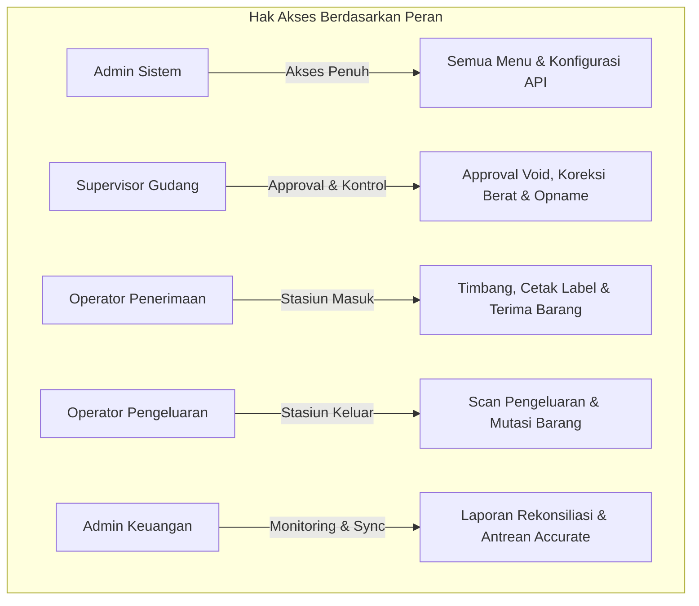
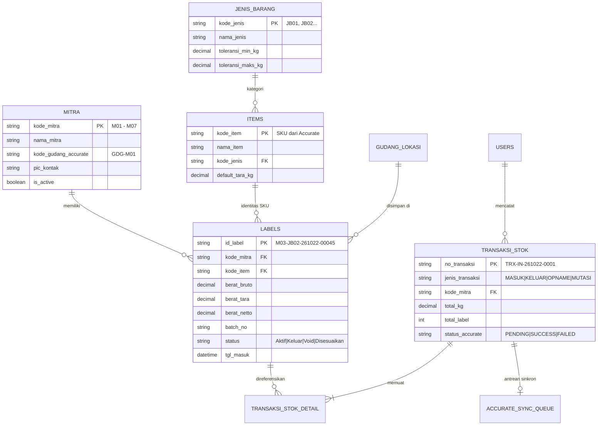
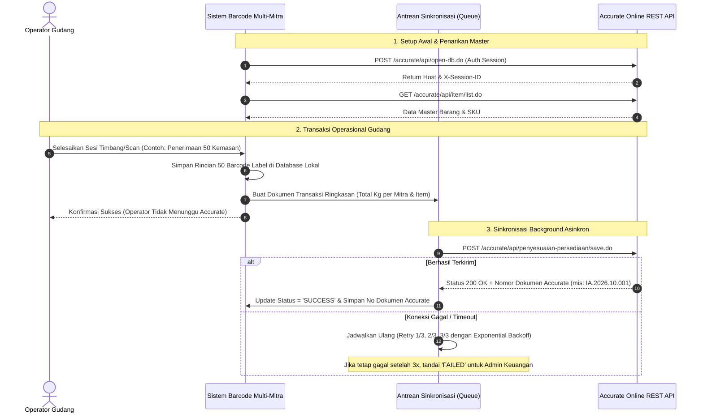
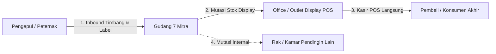

# 📦 PRD: Sistem Barcode Inventory Multi-Mitra (Catch-Weight)
> **Spesifikasi Kebutuhan Produk (Product Requirement Document)**  
> **Status:** 🟢 *Siap Diimplementasikan (Ready for Implementation)*  
> **Versi Dokumen:** `1.1.0 (Enhanced Edition)`  
> **Tanggal Rilis:** 22 Oktober 2026 | **Pemilik Dokumen:** `@SMO & Architecture Team`  
> **Integrasi Utama:** Accurate Online API (OAuth 2.0)  
> **Platform Target:** Web Responsif (PC Stasiun Timbang & Mobile/Handheld Scanner Android)

---

## 📌 1. Ringkasan Eksekutif & Latar Belakang

Sistem Barcode Inventory Multi-Mitra dirancang khusus untuk mengelola pergudangan barang dengan karakteristik **berat bervariasi (*catch-weight*)** milik **7 Mitra bisnis**. Setiap kemasan fisik barang diidentifikasi secara unik menggunakan satu label barcode yang memuat nomor seri unik dan berat aktual (*netto*). 

Sistem ini memecahkan kendala pemisahan stok multi-entitas, menghilangkan selisih timbangan manual, dan **terhubung langsung secara otomatis dua arah ke Accurate Online via API**.

```
  [ Timbangan Digital ] ──(RS-232/USB)──┐
                                         ▼
[ Fisik Kemasan ] ───▶ [ Stasiun Timbang & Cetak ] ──▶ [ Label Barcode 100x50 mm ]
                                         │
                                         ▼
                           [ Database Sistem Barcode ]
                           (Stok Real-time: 7 Mitra)
                                         │
                         (Antrean Sinkronisasi Otomatis)
                                         ▼
                        [ Accurate Online REST API ]
                       (Jurnal & Penyesuaian Stok Otomatis)
```

---

## 🎯 2. Matriks Permasalahan & Solusi

| No | Masalah Operasional Saat Ini | Dampak Bisnis | Solusi dalam Sistem Barcode v1 |
|:--:|:---|:---|:---|
| **1** | Stok milik 7 mitra tercampur di gudang fisik. | Sulit menjawab *"Berapa kg barang jenis A milik Mitra X hari ini?"*. Risiko salah kirim antar mitra. | **Segregasi Multi-Mitra**: Setiap label terikat mutlak ke 1 mitra (`M01`–`M07`). Laporan stok per mitra *real-time*. |
| **2** | Berat kemasan bervariasi (*catch-weight*), pencatatan manual sering salah ketik (*human error*). | Klaim selisih berat dari mitra/pelanggan, margin rugi, rekap lambat. | **Auto-Capture Berat**: Terhubung langsung ke timbangan digital (RS-232/USB Web Serial). Hitung otomatis *Netto = Bruto − Tara*. |
| **3** | *Double data-entry* (input manual di gudang lalu input ulang di Accurate). | Selisih saldo pembukuan vs fisik, admin lembur merekap data. | **Integrasi API Accurate Online**: Pengiriman data transaksi otomatis via antrean *background*. Tanpa input ganda. |
| **4** | Laporan berkala ke mitra memakan waktu lama. | Rekapitulasi manual butuh berjam-jam setiap kali mitra meminta stok. | **Ekspor 1-Klik**: Laporan stok per mitra dalam format PDF / Excel siap kirim dalam < 5 detik. |

---

## 📐 3. Ruang Lingkup Proyek (Scope of Work)

### 3.1 Fitur Masuk Lingkup (Fase 1 - Wajib / P1)
- ✅ **Master Data Hub**:
  - **Master Mitra Bisnis**: Kelola data 7 Mitra (`M01`–`M07`), PIC, telepon, pemetaan gudang Accurate, dan warna identitas UI.
  - **Master Produk**: Katalog master barang hasil laut (Udang, Cumi, Ikan, Teri, Rebon), kategori/jenis master, bobot langsung dihitung dalam kilogram (KG) tanpa tara atau toleransi.
  - **Master Harga**: Matriks daftar harga jual/kontrak per Kg untuk masing-masing 7 mitra (setiap mitra memiliki harga berbeda meskipun barangnya sama).
- ✅ **Penerimaan (Stasiun Timbang & Cetak Label)**:
  - **Cukup dengan Berat Saja**: Operator cukup memasukkan atau memilih bobot aktual (*netto*), tanpa kerumitan perhitungan manual.
  - **Surat Jalan Otomatis**: Menggantikan nomor batch konvensional. Begitu ada barang masuk, sistem otomatis menghasilkan Nomor Surat Jalan unik (`SJ-[Mitra]-[YYMMDD]-[Urut]`).
  - **Auto-Price Realtime**: Ketika memilih mitra dan jenis produk, nominal harga per kg dan total nilai barang otomatis tampil sesuai data Master Harga.
  - Koneksi timbangan digital (RS-232 / USB via Web Serial API).
  - Validasi batas toleransi berat minimum dan maksimum jenis barang.
  - Cetak label thermal 100 × 50 mm (Barcode Code 128 + QR Code + Berat Netto Besar + No. SJ + Nilai).
  - Mode cetak massal, cetak ulang dengan alasan & log audit, serta pembatalan (*void*).
- ✅ **Penerimaan Barang (*Inbound*)**: Label tercetak otomatis menjadi barang berstatus `Aktif`.
- ✅ **Pemindahan Stok & Mutasi Multi-Tahap (Custody Transfer)**:
  - Alur 1: **Pengepul / Peternak ➔ Gudang Pusat 7 Mitra** (Inbound sumber).
  - Alur 2: **Gudang 7 Mitra ➔ Office / Outlet Display POS** (Transfer stok display).
  - Alur 3: **Gudang / Office ➔ Pembeli Langsung (POS Accurate)** (Penjualan kasir).
  - Alur 4: **Mutasi Antar Rak / Kamar Pendingin** (Internal gudang).
- ✅ **Dokumen Berita Acara Serah Terima (BAST)**:
  - Pencatatan resmi pihak penyerah dan penerima yang mengikat **User Login** aktif.
  - Cetak dokumen BAST format A4 dengan rincian kemasan, bobot netto, QR verifikasi, dan 3 kolom tanda tangan resmi.
- ✅ **Pengeluaran Barang (*Outbound*)**:
  - Scan barcode untuk verifikasi sebelum keluar (mencegah salah ambil milik mitra lain).
  - Validasi status label: wajib `Aktif`, sesuai mitra transaksi, dan berada di gudang asal.
- ✅ **Stok Opname Digital**:
  - Scan fisik seluruh label di gudang.
  - Deteksi otomatis: label belum terscan (*missing*), label asing, dan selisih berat akumulatif.
- ✅ **Laporan Multi-Mitra**:
  - Matriks Stok: 7 Mitra × Jenis Barang (Total Kg & Jumlah Kemasan/Pcs).
  - Kartu stok per item & riwayat pergerakan per nomor label barcode (*traceability*).
  - Ekspor format PDF dan Excel.
- ✅ **Integrasi API Accurate Online**:
  - Autentikasi OAuth 2.0 & manajemen sesi `open-db.do`.
  - Pemetaan 1 Mitra = 1 Gudang di Accurate (`GDG-M01` s/d `GDG-M07`).
  - Antrean pengiriman transaksi otomatis dengan mekanisme *retry* 3× bila koneksi terputus.

### 3.2 Di Luar Lingkup Fase 1 (Direncanakan pada Fase 2)
- ❌ Modul Penjualan & Pembelian penuh (tetap berjalan di Accurate Online).
- ❌ Portal *self-service* login khusus untuk mitra eksternal (Fase 2).
- ❌ Aplikasi *native* mobile Android/iOS (Fase 1 menggunakan *Responsive Web App* yang kompatibel dengan browser HP/Handheld Barcode Scanner Android).

---

## 👥 4. Matriks Pengguna & Hak Akses (User Roles)

Sistem menggunakan kontrol akses berbasis peran (*Role-Based Access Control - RBAC*):



| Peran (Role) | Tanggung Jawab Operasional | Akses Menu Utama | Mode Perangkat |
|:---|:---|:---|:---|
| **Admin Sistem** | Kelola pengguna, master mitra, konfigurasi koneksi API Accurate, log audit. | Akses penuh (*Superuser*) | PC Desktop |
| **Supervisor Gudang** | Validasi selisih berat di luar toleransi, approve *void label*, validasi hasil opname. | Seluruh transaksi gudang + Menu Approval | PC / Tablet |
| **Operator Penerimaan** | Menimbang kemasan fisik, cetak label barcode, konfirmasi dokumen penerimaan. | Stasiun Timbang & Cetak, Penerimaan Barang | PC Stasiun Timbang |
| **Operator Pengeluaran**| Scan label untuk pengiriman keluar, validasi barang keluar, cek mutasi. | Pengeluaran Barang, Mutasi, Stok Opname | Handheld Android / HP |
| **Admin Keuangan** | Pantau status sinkronisasi Accurate, memicu *retry* jika ada antrean gagal. | Laporan Stok, Antrean Integrasi API | PC Desktop |

---

## 📊 5. Konsep & Struktur Data Utama

### 5.1 Entitas & Aturan Kunci (*Business Rules*)

1. **Satuan Ganda (*Dual-Unit Metric*)**:
   - Satuan Utama: **Kilogram (Kg)** dengan tingkat ketelitian hingga `0.01 kg`.
   - Satuan Sekunder: **Jumlah Label / Kemasan (*Pcs/Bags*)**.
2. **Keterikatan Tunggal (*Single-Ownership*)**:
   - Setiap label barcode hanya boleh dimiliki oleh tepat **1 Mitra**.
   - Barang tidak dapat dikeluarkan atas nama mitra yang berbeda dari label barcode.
3. **Kalkulasi Berat**:
   $$\text{Berat Netto} = \text{Berat Bruto} - \text{Tara (Kemasan)}$$
   Jika Berat Netto berada di luar rentang toleransi $[\text{Min}, \text{Maks}]$ pada master Jenis Barang, sistem mewajibkan otorisasi supervisor sebelum label dapat dicetak.
4. **Siklus Hidup Label (*State Machine*)**:
   - `Aktif` $\rightarrow$ Label telah dicetak dan barang berada di gudang.
   - `Keluar` $\rightarrow$ Label telah discan keluar (pengiriman/pemakaian). Label tidak dapat discan keluar untuk kedua kalinya.
   - `Void` $\rightarrow$ Label dibatalkan/rusak sebelum barang masuk (memerlukan alasan pembatalan).
   - `Disesuaikan` $\rightarrow$ Label mengalami perubahan berat hasil timbang ulang / penyesuaian.

### 5.2 Diagram Relasi Entitas (ERD)



---

## 🏷️ 6. Desain Barcode & Label Fisik (Thermal 100 × 50 mm)

### 6.1 Format ID Label Barcode
Nomor barcode didesain menggunakan format terstruktur agar informatif bagi operator bahkan sebelum discan:

$$\mathbf{[KodeMitra] - [KodeJenis] - [YYMMDD] - [NomorUrut]}$$

*Contoh ID:* `M03-JB02-261022-00045`  
- `M03` = Mitra 03  
- `JB02` = Jenis Barang 02 (misal: Kemasan Vakum / Potongan Beku)  
- `261022` = Tanggal Produksi/Timbang (22 Oktober 2026)  
- `00045` = Nomor Urut Kemasan ke-45 pada hari tersebut untuk mitra bersangkutan (reset harian).

### 6.2 Tata Letak Label Thermal (100 × 50 mm)

```
┌────────────────────────────────────────────────────────────────────────┐
│  PT LOGISTIK BERSAMA GUDANG                          [ MITRA 03 ]      │
├────────────────────────────────────────────────────────────────────────┤
│  ITEM : DAGING SAPI SANDUNG LAMUR PREMIUM                              │
│  JENIS: FROZEN MEAT (JB02)                  BATCH: B-20261022-A        │
├────────────────────────────────────────────────────────────────────────┤
│   NETTO (BERAT BERSIH):                                                │
│      ██████╗  ██╗  ██╗      ██████╗  ███████╗   KG                     │
│      ╚════██╗ ██║  ██║     ██╔════╝  ██╔════╝                          │
│       █████╔╝ ███████║     ██║  ███╗ ███████╗                          │
│       ╚═══██╗ ╚════██║     ██║   ██║ ╚════██║   (24.35 Kg)             │
│      ██████╔╝      ██║  •  ╚██████╔╝ ███████║                          │
│                                                                        │
│   Bruto: 25.00 Kg  |  Tara: 0.65 Kg  |  Toleransi: OK                  │
├────────────────────────────────────────────────────────────────────────┤
│   BARCODE (CODE 128):                                                  │
│   ║▌║█║▌│║▌║▌█║██║▌║█║▌│║▌║▌█║██║▌║█║▌│║▌║▌█║   [ QR CODE ]            │
│   *M03-JB02-261022-00045*                       Scan HP/Mobile         │
├────────────────────────────────────────────────────────────────────────┤
│   Tgl: 22-10-2026 14:32  |  Opr: OPR-BAMBANG  |  Lokasi: RAK-B2-04     │
└────────────────────────────────────────────────────────────────────────┘
```

> **Catatan Teknis Label:**
> 1. Menggunakan simbologi **Code 128 (Auto)** sebagai standar industri yang dapat dibaca cepat oleh semua scanner barcode 1D (Laser/CCD).
> 2. Disertai **QR Code** di sisi kanan untuk mempermudah scan menggunakan kamera smartphone operator pengeluaran.
> 3. Angka **Netto** dicetak dengan font ekstra besar (*high contrast*) agar mudah dibaca dari jarak 2 meter di area gudang.

---

## 🔄 7. Integrasi API Accurate Online

Sistem barcode bertindak sebagai sistem eksekusi gudang (*Warehouse Execution System*), sedangkan Accurate Online bertindak sebagai sistem pembukuan finansial (*General Ledger & Inventory Master*).



### 7.1 Aturan Pemetaan Data (*Data Mapping*)
- **Pemetaan Mitra ke Gudang Accurate**: Setiap mitra dipetakan ke 1 ID Gudang di Accurate Online (contoh: Mitra `M01` dipetakan ke gudang `GDG-MITRA-01`).
- **Nomor Transaksi Unik (*Idempotency*)**: Setiap pengiriman ke Accurate menyertakan `transNo` unik dari sistem barcode untuk mencegah risiko pencatatan ganda (*duplicate submission*) saat koneksi terputus di tengah jalan.
- **Master Barang Tunggal**: Data SKU/Item ditarik langsung dari Accurate Online agar penamaan dan kode barang selalu 100% konsisten.

### 7.2 Alur Mutasi Pergerakan Barang & Integrasi Fitur POS Accurate

Sistem mendukung perpindahan fisik barang (*custody transfer*) secara bertingkat dan mengaitkan setiap perpindahan dengan transaksi Accurate Online serta Berita Acara Serah Terima (BAST):



1. **Alur 1: Pengepul / Peternak ➔ Gudang 7 Mitra**
   - Karakteristik: Penerimaan awal barang mentah / karkas.
   - Aksi Sistem: Timbang brutto, potong tara kemasan, cetak label barcode 100×50 mm. Stok masuk ke gudang mitra bersangkutan (`GDG-M01` s/d `GDG-M07`).
   - Sinkronisasi Accurate: Masuk antrean *Penyesuaian Persediaan (Penambahan)* atau *Penerimaan Barang*.

2. **Alur 2: Gudang 7 Mitra ➔ Office / Outlet POS**
   - Karakteristik: Pengiriman stok dari gudang cold storage mitra ke ruang display office / toko kasir POS.
   - Aksi Sistem: Scan barcode kemasan, status barcode tetap `Aktif`, namun lokasi fisik berpindah ke `GDG-OFFICE-POS`.
   - Sinkronisasi Accurate: Diteruskan ke endpoint REST API Accurate `/accurate/api/item-transfer/save.do` (Pindah Barang antar Gudang).

3. **Alur 3: Office / Outlet POS ➔ Pembeli Langsung (Fitur POS Accurate)**
   - Karakteristik: Transaksi ritel / langsung di kasir office (POS).
   - Aksi Sistem: Kasir men-scan barcode pada saat pelanggan checkout. Status label berubah menjadi `Keluar`.
   - Sinkronisasi Accurate: Terintegrasi dengan fitur POS Accurate melalui endpoint Faktur Penjualan `/accurate/api/sales-invoice/save.do`, mengurangi stok di Accurate dan membukukan pendapatan penjualan.

4. **Alur 4: Mutasi Internal Antar Rak / Kamar Pendingin**
   - Karakteristik: Reposisi susunan rak / lot di dalam gudang tanpa mengubah kepemilikan mitra.

### 7.3 Berita Acara Serah Terima (BAST) Berbasis User Login

Setiap mutasi barang wajib disertai dokumen formal **Berita Acara Serah Terima (BAST)** untuk menjamin akuntabilitas:
- **Binding User Login**: Sistem secara otomatis mengikat identitas penerima dengan akun yang sedang aktif login (`$_SESSION['user_login']`), mencegah manipulasi nama penerima.
- **Penomoran Unik BAST**: Format otomatis `BAST-YYMMDD-XXXX` (contoh: `BAST-261022-0001`).
- **Dokumen Cetak Format A4 Standar**:
  - Header resmi perusahaan dan nomor transaksi.
  - Tabel rincian kemasan yang diserahterimakan (No Barcode, Item SKU, Mitra Pemilik, Bobot Netto Catch-Weight).
  - Ringkasan total koli/kemasan dan total bobot netto (Kg).
  - Tiga kolom tanda tangan basah / digital: **Pihak Yang Menyerahkan**, **Pihak Yang Menerima (User Login)**, dan **Mengetahui (Supervisor/Kepala Gudang)**.
  - QR Code verifikasi dokumen digital.

---

## ⏱️ 8. Kebutuhan Non-Fungsional (*Non-Functional Requirements*)

| Kategori | Parameter | Spesifikasi Target |
|:---|:---|:---|
| **Performa Kecepatan** | Respon Scan Barcode | `< 0.8 detik` dari scan hingga data kemasan muncul di layar |
| | Kecepatan Cetak Label | `< 2.5 detik` dari klik/timbang hingga label keluar dari printer thermal |
| **Keandalan (*Offline Resiliency*)** | Putus Koneksi Internet | Stasiun gudang **tetap beroperasi 100%** mencetak & menimbang tanpa internet. Data otomatis masuk antrean (*buffer queue*) dan tersinkron saat internet pulih. |
| **Akurasi Timbangan** | Resolusi Data | `0.01 kg` (2 digit desimal) langsung ditarik otomatis dari timbangan digital tanpa ketik manual. |
| **Audit & Kepatuhan** | Jejak Audit (*Audit Trail*) | Semua perubahan data label, cetak ulang, void, dan nama operator tercatat permanen (*immutable log*). |
| **Skalabilitas** | Kapasitas Beban | Mampu menampung hingga 50 mitra dan > 500.000 record label per tahun tanpa penurunan performa. |

---

## 📅 9. Roadmap Implementasi Bertahap

```
[ Fase 1: Fondasi & Master ] ──────▶ [ Fase 2: Timbang & Penerimaan ]
  • Skema Database & Migrasi           • Koneksi Timbangan (Serial/USB)
  • Koneksi API Accurate (OAuth)        • Desain & Print Label 100x50 mm
  • Sinkronisasi Master SKU             • Inbound Barcode Scan
  • Pemetaan 7 Mitra ke Gudang          • Pilot Test 1 Mitra
                                                │
                                                ▼
[ Fase 4: Optimasi & Dashboard ] ◀─── [ Fase 3: Pengeluaran & Opname ]
  • Rekonsiliasi Harian Otomatis        • Outbound Scan & Validasi Mitra
  • Ekspor Laporan Otomatis             • Modul Stok Opname Digital
  • Penimbangan Ulang (Susut)           • Roll-out ke 7 Mitra Penuh
```

---

## ❓ 10. Checklist Kesiapan & Pertanyaan Terbuka

- [x] **Format Barcode**: Disepakati menggunakan **Code 128** dengan format `[Mitra]-[Jenis]-[YYMMDD]-[Urut]`.
- [x] **Ukuran Label Fisik**: Disepakati ukuran standar industri **100 × 50 mm**.
- [ ] **Pemetaan Mitra di Accurate**: Konfirmasi nama/kode gudang di Accurate untuk masing-masing 7 Mitra.
- [ ] **Protokol Timbangan**: Pastikan model timbangan digital memiliki port serial (RS-232) atau USB dengan mode *continuous output* atau *command request*.
- [ ] **Model Printer Thermal**: Disarankan printer thermal desktop kelas industrial (misal: TSC TTP-244 Pro, Zebra ZD220, atau Xprinter XP-420B).

---
*Dokumen ini merupakan acuan resmi pengembangan aplikasi Barcode Inventory Multi-Mitra.*
