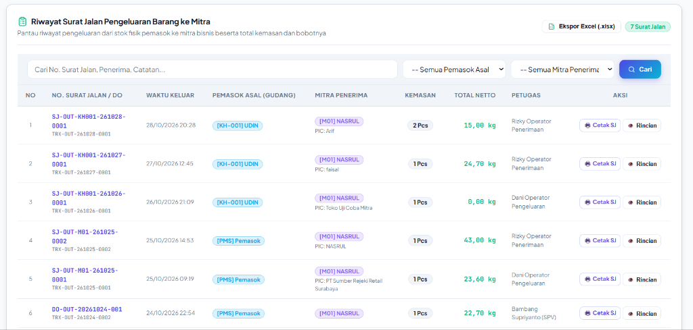
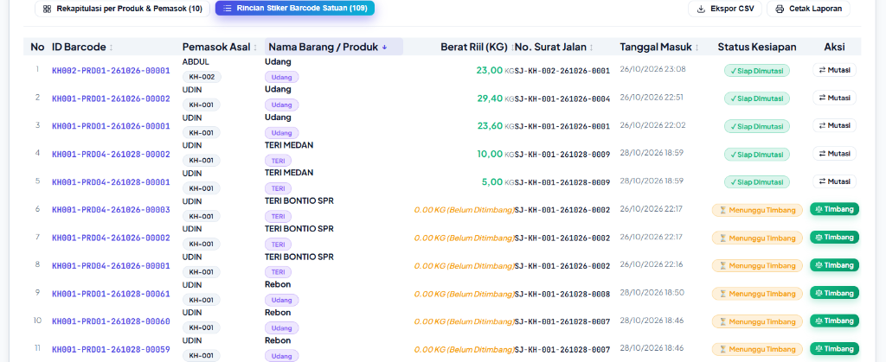
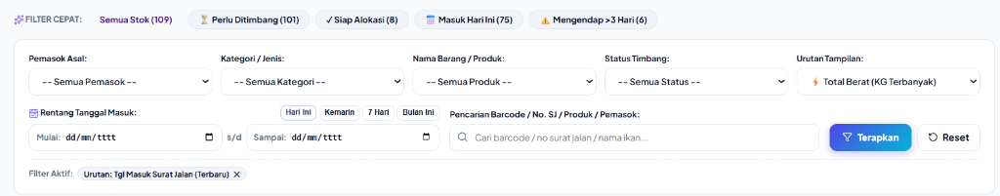
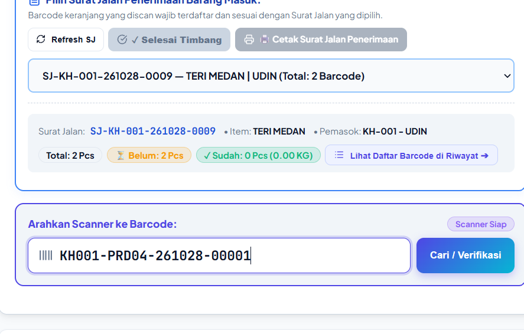
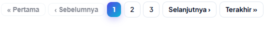

# 🧭 AUDIT & ROADMAP PENYEDERHANAAN TOMBOL (UI CLUTTER REDUCTION)
## WMS & Sistem Barcode Multi-Mitra (Catch-Weight)

> **Ringkasan Temuan:**  
> Seiring bertambahnya fitur operasional, antarmuka mengalami **button overload (kepadatan tombol)**. Banyak tombol memiliki visual weight yang setara, tombol sampingan merebut perhatian dari aksi utama operator, serta kolom aksi di tabel memakan lebar layar.  
> Dokumen ini memetakan tangkapan layar langsung (*screenshot*) dari masalah tersebut dan menyusun urutan eksekusi perbaikannya.

---

## 📸 1. ANALISIS MASALAH BERDASARKAN SCREENSHOT

### A. Masalah Tombol Filter Dobel & Berjejal (Button Clutter di Toolbar)


* **Titik Masalah:**
  1. Tombol `Cari` (biru solid) berdiri sendiri di samping input search, padahal operator lebih terbiasa menekan tombol `Enter`.
  2. Di atas tabel terdapat tombol `Ekspor Excel (.xlsx)` yang bersaing warna dengan badge `7 Surat Jalan`.
  3. Di kolom aksi tabel, setiap baris memiliki dua tombol teks panjang: `🖨️ Cetak SJ` dan `👁️ Rincian`.

---

### B. Masalah Kolom Aksi Tabel Terlalu Padat (Multi-Action Sprawl)


* **Titik Masalah:**
  1. Setiap baris tabel dihiasi tombol `Timbang` (hijau) atau `Mutasi` (outline) yang lebarnya menyita ruang tabel.
  2. Di toolbar atas terdapat switch view `Rekapitulasi`, `Rincian Stiker`, `Ekspor CSV`, dan `Cetak Laporan` yang berjejer sekaligus.
  3. Teks tombol yang panjang memaksa pengguna laptop/tablet melakukan horizontal scroll.

---

### C. Masalah Rentang Tanggal Preset yang Terlalu Banyak Tombol


* **Titik Masalah:**
  1. Terdapat 4 tombol mini berturut-turut: `Hari Ini`, `Kemarin`, `7 Hari`, `Bulan Ini`.
  2. Tombol `Terapkan` dan `Reset` bersanding langsung di sebelah input search.
  3. Filter chips di bagian bawah kembali memunculkan tombol silang individual `✕`.

---

### D. Masalah Tombol Operasional Stasiun Timbang


* **Titik Masalah:**
  1. Di panel atas ada 3 tombol: `Refresh SJ`, `✓ Selesai Timbang`, dan `🖨️ Cetak Surat Jalan Penerimaan`.
  2. Di bawahnya ada tombol navigasi `Lihat Daftar Barcode di Riwayat ➔`.
  3. Di kotak scanner terdapat tombol `Cari / Verifikasi` yang sebenarnya tidak perlu ditekan jika scanner barcode sudah otomatis mengirim karakter enter.

---

### E. Acuan Desain Bersih: Pagination Standar yang Telah Diterapkan


* **Kondisi Positif:**
  - Hanya nomor halaman aktif yang memiliki warna solid.
  - Tombol lainnya (`« Pertama`, `‹ Sebelumnya`, `Selanjutnya ›`, `Terakhir »`) menggunakan warna outline netral yang tidak membuat silau mata operator.

---

## 🚦 2. URUTAN PRIORITAS PERBAIKAN (ROADMAP)

Tabel urutan kerja dari yang paling mendesak hingga penyempurnaan akhir:

| Prioritas | Halaman Target | Bukti Screenshot Terkait | Rencana Aksi Pembersihan |
| :---: | :--- | :--- | :--- |
| **P1** | **`views/pengeluaran.php`** | [Lihat Screenshot A](#a-masalah-tombol-filter-dobel--berjejal-di-toolbar) | 1. Hilangkan tombol `Cari` (jadikan search on Enter / debounce).<br>2. Ubah tombol `🖨️ Cetak SJ` & `👁️ Rincian` per baris menjadi icon-buttons hemat ruang.<br>3. Satukan ekspor ke toolbar pojok kanan. |
| **P2** | **`views/timbang_cetak.php`** | [Lihat Screenshot B](#b-masalah-kolom-aksi-tabel-terlalu-padat-multi-action-sprawl) & [C](#c-masalah-rentang-tanggal-preset-yang-terlalu-banyak-tombol) | 1. Ganti 4 tombol preset tanggal jadi single dropdown `📅 Periode ▼`.<br>2. Kolom aksi tabel dibuat dinamis (hanya tampilkan 1 aksi relevan per baris).<br>3. Satukan tombol cetak laporan & CSV jadi 1 dropdown ekspor. |
| **P3** | **`views/mutasi.php`** | [Lihat Screenshot D](#d-masalah-tombol-operasional-stasiun-timbang) | 1. Sembunyikan shortcut testing/sample barcode.<br>2. Ganti tombol teks `Lihat Alur` per baris menjadi klik interaktif pada ID Barcode atau icon `ℹ️`. |
| **P4** | **`views/stok_mitra.php`** | Form & Tabel Matriks | 1. Hilangkan tombol `Filter Mitra Ini` di setiap kartu (jadikan seluruh kartu clickable).<br>2. Satukan tombol `CSV` dan `Ekspor Excel`. |
| **P5** | **`views/master.php`** | Master Data Items & Pemasok | 1. Standarisasi tombol CRUD Edit/Hapus jadi icon-only buttons. |

---

## 🎨 3. STANDAR DESAIN BARU (CLEAN BUTTON SYSTEM)

```
[ Input Pencarian dengan Ikon Kaca Pembesar di Dalam ]   [ ⚙ Filter ]   [ 📥 Ekspor ▼ ]
```

1. **Aturan 1 Tombol Solid per Card:**
   - Hanya tombol eksekusi utama yang boleh berwarna solid (misal: *Simpan*, *Timbang*, *Keluarkan Barang*).
   - Filter, Reset, Ekspor, dan Aksi baris tabel wajib bertipe `btn-outline` atau `icon-button`.
2. **Pencarian Tanpa Tombol "Cari":**
   - Menggunakan event keypress `Enter` atau auto-debounce 300ms.
3. **Kolom Aksi Hemat Ruang:**
   - Tidak ada tombol teks panjang di dalam tabel data. Gunakan icon dengan `title/tooltip`:
     - `🖨️` untuk Cetak
     - `👁️` untuk Lihat Detail / Rincian
     - `⋮` untuk menu tindakan lainnya
